# 🐴 agent-tracker

> **A local-first, Git-backed execution harness designed for AI coding agents and human-in-the-loop engineering.**

[](LICENSE)
[](https://nodejs.org/)
[](#architecture)
[](https://nextjs.org/)

`agent-tracker` is an engineering discipline harness and Kanban engine built to prevent AI coding agents (OpenCode, Claude Code, Cursor, Codex) from drifting, skipping verification, or producing sprawling, unreviewable pull requests.

It keeps the agent grounded by maintaining a single source of truth in SQLite (`kanban.db`) inside your repository, exposing an ultra-fast CLI for the agent to inspect its boundaries, and providing a real-time visual control room with Server-Sent Events (SSE) for human oversight.

---

## ⚡ The Agent Discipline Loop

```mermaid
graph LR
    A[CLI: next] -->|Fetch Frontier Ticket| B[Agent: in_progress]
    B -->|Implement Atomic Scope| C[Local Codebase]
    C -->|Run Real Tests / E2E| D[Terminal Evidence]
    D -->|CLI: status in_review --evidence| E[Kanban State Machine]
    E -->|Git Commit: 1 Ticket = 1 Commit| F[Verified Progress]
```



---

## 🎯 Core Principles

- **Git-Native & Zero-Cloud:** State is persisted in `kanban.db` and tracked directly in Git. Your workflow travels with your repository without third-party vendor lock-in.
- **Topological Frontier:** Agents work sequentially. A ticket cannot be picked up until all prerequisite sibling tickets are marked `done`.
- **Atomic Commits (1 Ticket = 1 Commit):** Agents are expected to decompose complex technical architecture into isolated, verifiable steps.
- **Verifiable Evidence Required:** Moving a ticket to `in_review` or `done` strictly requires terminal execution proof (e.g., test suite output, curl responses, migration verification).
- **Sub-100ms CLI:** Zero startup compilation latency. Built with Clean Architecture and distributed pre-compiled for instant agent execution.
- **Real-Time Visual Board:** A read-only Next.js interface with Server-Sent Events (SSE), full-width AC/DoD documentation tabs, and native client-safe Mermaid diagram rendering.

---

## 📦 Directory Structure & Clean Architecture

```
tracker/
├── app/                  # Next.js 16 App Router (Read-only UI)
│   ├── api/              # SSE (/api/events) and JSON data endpoints
│   ├── backlog/[id]/     # Backlog detail view with tabbed AC / DoD / Notes
│   └── ticket/[id]/      # Atomic ticket detail view with execution evidence
├── components/           # React 19 UI components (Board, Mermaid, Markdown)
├── lib/                  # Database access, types, and client-side hooks
├── scripts/
│   ├── build-cli.cjs     # esbuild script compiling CLI to dist/cli.mjs (<100ms)
│   └── snapshot.tsx      # Headless static HTML snapshot generator
├── src/                  # Clean Architecture Core
│   ├── domain/           # Entities (Brd, Backlog, Ticket), states, and errors
│   ├── application/      # Use cases (ListFrontier, ChangeStatus, SyncSeed, etc.)
│   ├── infrastructure/   # SQLite repository (node:sqlite) and seed parsers
│   ├── presentation/     # Commander.js CLI and formatters
│   └── cli.ts            # CLI composition root
├── cli.mjs               # Fast executable shim with automatic fallback
├── schema.sql            # Core SQLite schema definition
└── kanban.db             # SQLite database file (committed to Git)
```

---

## 🚀 Quick Start

### 1. Installation & Zero-Friction Setup
Inside your project root directory:
```bash
# 1. Clone into your project (e.g. tracker/ or agent-tracker/)
git clone https://github.com/zakyyudha/agent-tracker.git tracker
cd tracker

# 2. Install dependencies
pnpm install

# 3. Run automated project setup
# - Installs agent skill into ../.agents/skills/agent-tracker/
# - Configures ../AGENTS.md with the Agent Discipline Loop & SAD/PRD Detailing rules
# - Precompiles the CLI for sub-100ms execution
pnpm setup
```

### 2. Inspecting the Frontier
Find the next unblocked ticket ready for execution:
```bash
node cli.mjs next
```

### 3. Updating Status with Evidence
```bash
# Claim ticket
node cli.mjs status <ticket-id> in_progress

# Submit for review with verifiable proof
node cli.mjs status <ticket-id> in_review --evidence "pnpm test src/auth -- --passWithNoTests (All 14 suites passed)"

# Mark completed after review
node cli.mjs status <ticket-id> done
```

### 4. Running the Real-Time Observer
```bash
# Start Next.js read-only realtime board on port 3100
pnpm start
# Open http://localhost:3100
```

### 5. Generating Offline Static Snapshot
```bash
node cli.mjs render
# Generates index.html with inline styles for standalone browsing
```

---

## 🧠 Agent Skill & Instructions Integration

`agent-tracker` includes automated setup for your AI coding agents:

- **Skill:** [`skills/agent-tracker/SKILL.md`](skills/agent-tracker/SKILL.md)
- **Instructions Template:** [`templates/AGENTS.template.md`](templates/AGENTS.template.md)

Running `pnpm setup` automatically copies the skill to `.agents/skills/agent-tracker/` and configures `AGENTS.md` at your project root. When installed, AI coding agents (Antigravity, OpenCode, Claude Code, Cursor, Codex) automatically discover the harness and enforce:
- High-fidelity detailing from SAD/PRD (AC Gherkin, DoD quality bars, Notes Mermaid & DDL schemas).
- Ticket-level scope via `--desc-file`.
- Topological task frontier adherence.
- 1 ticket = 1 isolated commit.

## 🛠️ CLI Reference

### Basic Commands
| Command | Description |
|---|---|
| `node cli.mjs next [n]` | List the top unblocked frontier tickets |
| `node cli.mjs stats` | Overview summary of statuses and story points |
| `node cli.mjs show <id> [--json]` | Full context (AC, DoD, Notes, BRD, and siblings) |
| `node cli.mjs render` | Re-render standalone `index.html` static snapshot |
| `node cli.mjs status <id> <status> [--evidence "<proof>"]` | State machine transition |

### CRUD Operations
- **Backlog:** `node cli.mjs backlog list|show|add|update|delete`
- **Ticket:** `node cli.mjs ticket list|show|add|update|delete|status`
- **Business Requirement (BRD):** `node cli.mjs brd list|add`

Flag `--json` can be passed anywhere to generate structured output for AI agents.

---

## 📄 License
MIT
