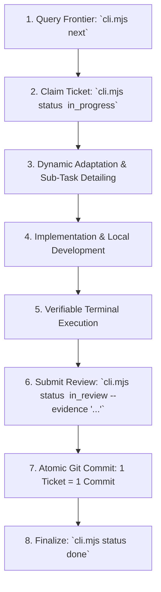

# Agent Instructions & Execution Discipline (agent-tracker)

This repository enforces an evidence-driven, atomic execution harness powered by **`agent-tracker`**. All AI coding agents (Antigravity, OpenCode, Claude Code, Cursor, Codex) must strictly follow these rules.

---

## 🎯 The Single Source of Truth

- **Database:** `kanban.db` (SQLite) tracked in Git. No cloud task manager or external state.
- **Single-Writer Rule:** All task status, backlog, and ticket modifications must go strictly through the CLI (`node <tracker-dir>/cli.mjs`). Never execute ad-hoc SQL or scripts against `kanban.db`.
- **Live Observability:** Run `pnpm start` (or `pnpm dev`) inside the tracker directory to view the real-time read-only Kanban board (with Server-Sent Events).

---

## ⚡ The Agent Discipline Loop

Agents must never work on arbitrary tickets. Work strictly on the **frontier** in this sequence:



1. **Query the Frontier:**
   ```bash
   node <tracker-dir>/cli.mjs next 3
   ```
   *Only tickets where all preceding sibling tickets are `done` will appear in the frontier.*

2. **Claim Task:**
   ```bash
   node <tracker-dir>/cli.mjs status <ticket-id> in_progress
   ```

3. **Atomic Execution (1 Ticket = 1 Commit):**
   - Keep diffs small, isolated, and focused solely on the claimed ticket.
   - Commit format: `<type>(<ticket-id>): <concise message>` (e.g. `feat(TASK-001-T2): implement streaming proxy router`).

4. **No Proof, No Progress (Verifiable Evidence Required):**
   - It is strictly forbidden to claim a ticket is complete without terminal proof.
   - Run unit tests, integration tests, migrations, or cURL requests.
   - Transition to `in_review` with the exact execution proof:
     ```bash
     node <tracker-dir>/cli.mjs status <ticket-id> in_review --evidence "<command> -> <pass output summary>"
     ```

5. **Mark Done:**
   ```bash
   node <tracker-dir>/cli.mjs status <ticket-id> done
   ```

---

## 📐 Document Ingestion & Detailing Standard (SAD / PRD / Specs)

When ingesting an architecture document (SAD), product spec (PRD), or user story:

### 1. Modular Subsystem Decomposition
- **Do NOT cram a large architecture document into a single generic backlog.**
- Decompose the document into distinct, modular backlogs per domain subsystem or architectural boundary.
- For each backlog, create granular, sequential atomic tickets (`T1`, `T2`, `T3`...).

### 2. Mandatory Backlog Quality Standards
Never write vague one-sentence summaries. Always compile comprehensive markdown files in `.tmp/` and attach them via CLI:

- **Acceptance Criteria (`--ac-file <path>`):**
  - Concrete feature checklist with measurable criteria.
  - Skenario behavioral Gherkin (`Given ... When ... Then ...`).
  - Non-functional requirements (SLA latensi, throughput, error handling).
- **Definition of Done (`--dod-file <path>`):**
  - Code coverage thresholds (e.g. $\ge 80\%$).
  - Linting, formatting, and strict typecheck zero-error rules.
  - Zero manual DDL (migrations must be reversible).
- **Architectural Notes (`--notes-file <path>`):**
  - Visual Mermaid architecture & sequence diagrams.
  - Database schema definitions (DDL / tables / indexes).
  - Concrete API DTO JSON payloads (exact keys, types, examples).

### 3. Ticket-Level Scope & Deliverables
Each atomic ticket must declare its specific scope:
```bash
node <tracker-dir>/cli.mjs ticket update <ticket-id> --desc-file .tmp/<ticket-spec>.md
```
*Declare the exact files to touch, classes/functions to implement, and targeted test suites.*

---

## 🚫 Hallucination Guardrails

- **Zero "Blind Done":** Never mark tickets `done` based on assumptions or code inspection alone.
- **No Skipping States:** The state machine strictly enforces `todo → in_progress → in_review → done`.
- **Preserve Tracker Integrity:** Always commit `kanban.db` alongside the code changes in the same atomic commit.
